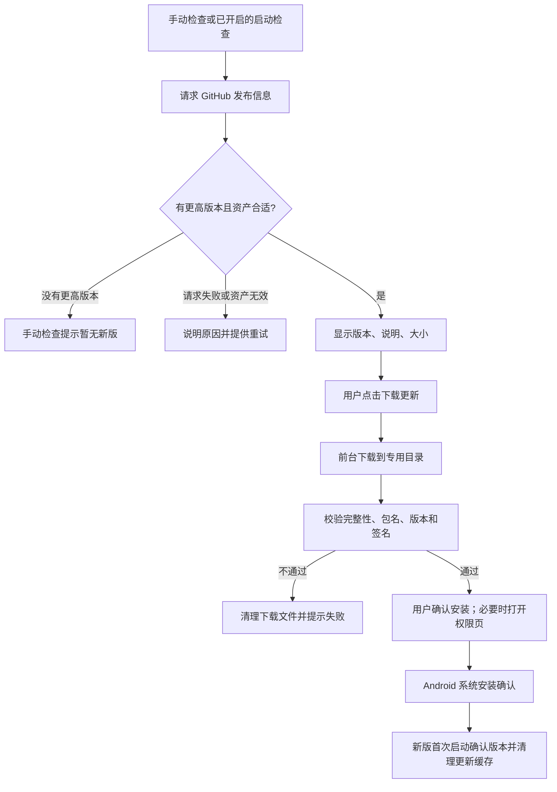

# Leaf 应用内更新方案

日期：2026-10-26

状态：需求范围已确认，方案已整理；功能尚未实现，本文的验收项尚未执行。

开发分支：`feature/leaf-in-app-update`，代码基线：`9244f128143409310c086910d552d3beeaec3e52`。

## 1. 目标和取舍

Leaf 当前检查到新版后会打开 GitHub 发布页，用户还需要选包、下载和打开安装包。本方案把这些操作放进应用：显示新版与说明，下载适配 Leaf5+ 的 ARM64 Release，校验后调用 Android 系统安装界面。用户仍需确认安装，首次还可能需要授予“安装未知应用”权限。

当前公开包约 23.38 MB。第一版使用单请求、从头下载，失败重试也重新下载；不保存分段进度，不做跨重启续传。这个选择减少了恢复状态，也避免旧文件与新版本片段混用。代价是网络中断后要重下整个包。

更新缓存集中在 Leaf 私有的 `updates/` 目录。启动时清半包，安装成功后由新版首次启动清完整包。只维护一个候选包，避免多次失败或多次更新积累文件。清理不依赖联网，也不依赖自动检查更新开关。

本次只增加 Android ARM64 Release 的应用内更新。不加入静默安装、后台常驻下载、镜像服务或自动下载；不改变漫画下载、阅读设置和数据迁移。其他平台保留原有发布页入口。Debug 与 Release 身份不同，Debug 不提供把正式包当作自身更新的安装按钮。

## 2. 用户流程



手动检查保留入口“设置 → 关于 → 检查更新”。发现新版后显示版本、更新说明、包大小，以及“下载更新”和“稍后”。更新说明作为文本或不执行脚本的 Markdown 展示，不执行 Release 内容中的指令。

下载时显示百分比和已下载量，提供取消。只在整数百分比变化或状态变化时刷新可见进度，避免每个网络数据块都引起墨水屏重绘。下载期间重复点击进入同一个任务，不创建第二个请求。关闭更新界面表示取消未完成下载。

校验完成后显示“安装”。首次缺少安装权限时，用户点击后进入 Leaf 对应的系统授权页；返回应用后重新检查授权并继续安装流程。拒绝授权、系统安装取消或安装失败都显示具体状态，允许再次安装或取消更新。切换到权限页或安装器不是关闭更新流程，不能因此删除完整 APK。

启动自动检查沿用现有开关，默认关闭；启用后沿用现有频率限制。启动检查失败仅记录日志，不弹错误打断阅读。手动检查和下载由用户主动发起，失败时显示提示。自动检查不会自动下载。

## 3. 两阶段校验和发布资产约定

发现新版时只有发布信息，能判断“是否有适合的包”，不能判断文件是否完整。下载完成后才检查 APK 内容，两个阶段都通过才允许安装。

| 阶段 | 输入 | 通过条件 | 不通过时 |
|---|---|---|---|
| 发布信息预检 | 同一条 GitHub Release 的版本、资产信息 | 当前渠道允许，版本更高，唯一匹配 ARM64 Release APK，地址和大小有效，有合法 SHA-256 摘要 | 说明无法使用应用内更新，允许重试或手动打开发布页 |
| 文件完整性检查 | 下载到本地的实际字节 | 实际长度与资产大小一致，SHA-256 与资产摘要一致 | 删除未交付安装器的文件，禁止安装 |
| 原生安装检查 | 实际 APK 与当前安装身份 | 包名一致，版本码更高，版本名对应候选，签名与当前 Leaf 一致，ABI 为 ARM64 | 明确拒绝，保留当前应用 |

摘要用于发现截断、损坏或内容变化；相同签名检查用于确认这是当前 Leaf 的兼容更新。只核对文件名或远端摘要不能替代 APK 身份检查。

<details>
<summary>发布资产和安装约束</summary>

<!-- @normative scope="review" -->
- U1：检查版本、读取更新说明和选择APK必须使用同一条Release记录；稳定版忽略draft和prerelease，保留既有版本比较规则。
- U2：只接受自有配置仓库的HTTPS发布资产。首次请求校验GitHub仓库路径；下载允许GitHub资产服务的HTTPS重定向，不允许降级到HTTP或转向本地/私网地址。复用现有代理配置，不携带漫画源Cookie或私有授权头。
- U3：资产选择同时支持既有手动发布名`Leaf-<version>-<versionCode>-release-arm64-v8a.apk`及构建产物名`VeneraNext-Leaf-<version>-android-arm64-v8a.apk`。版本必须对应所选Release，排除Debug和其他ABI；零个或多个匹配项均停止内置下载，不按列表顺序随便选一个。
- U4：资产必须包含正整数size、已上传状态和格式为`sha256:<64位十六进制>`的digest。digest缺失或格式错误时不跳过完整性检查，可提示手动打开发布页。第一版不引入第二套校验清单下载协议。
- U5：开始下载前及写入过程中检查大小；收到的字节超过声明size即取消。下载完成必须核对长度及实际SHA-256，禁止仅凭HTTP成功或content-length认定完成。
- U6：调用安装器前读取APK的实际packageName、longVersionCode、versionName、签名证书和原生库ABI。packageName须等于当前Leaf包名，longVersionCode须大于已安装版本，versionName须与所选Release一致。签名比较使用当前安装证书集合；第一版不引入签名密钥轮换。
- U7：Debug安装不得通过当前正式Release源原位更新。用户取消安装不卸载应用、不清除应用数据；测试和发布继续使用固定Leaf签名。
<!-- @endnormative -->

</details>

## 4. 网络与失败处理

应用直接访问GitHub API获取版本，不需要用户先在浏览器打开GitHub。设备仍需能访问API及安装包下载域名。API请求成功只说明版本检查可用，不能据此承诺APK可下载；连接Wi-Fi也不能证明GitHub可达。

下载使用已有网络配置和可取消请求，一次只拉取完整文件，不发送用于恢复旧文件的Range请求。重试前关闭前次连接和文件句柄，清理半包，从零下载。应用退到后台不建立常驻下载服务；操作系统可挂起或终止进程，重新启动按缓存恢复规则处理。

| 情况 | 用户看到的结果 | 缓存与后续动作 |
|---|---|---|
| API连接、DNS、TLS失败或超时 | 无法检查更新，并给出可理解的网络原因 | 不显示“已是最新版”；用户手动重试 |
| API限流或服务端错误 | 检查暂不可用；有重试时间时展示 | 不无限自动重试 |
| 已发现新版，但下载域名不可达 | 下载失败，已安装版本不受影响 | 关闭连接、删除半包，可重新下载 |
| 资产404或已被替换 | 安装包不可用或内容已变化 | 删除半包，重新检查发布信息 |
| 磁盘不足或写入失败 | 无法保存安装包 | 关闭文件、尝试清理；失败时阻止新任务继续堆积 |
| 哈希、签名、包名或版本不符 | 安装包校验失败 | 不调用安装器，清除未交付的候选 |
| 权限拒绝或安装取消 | 尚未安装 | 允许本轮重试；明确退出后按安装占用状态清理 |
| 私有缓存被系统回收 | 安装包已失效，需要重新下载 | 不使用旧路径启动安装，不影响当前应用 |

具体超时值复用项目已有网络约定，并在实现测试中记录，不新增面向用户的超时设置。任何技术错误都不能被转换成“没有新版本”。错误日志记录阶段、HTTP状态及候选版本，不记录凭据或签名URL中的敏感查询参数。

## 5. 专用目录和状态恢复

目录使用Android应用私有缓存根下的`updates/`，与现有漫画缓存管理器的`cache/`并列。避免把更新文件放进漫画缓存扫描范围；系统清理缓存造成文件丢失时，更新流程重新下载即可。

```text
应用私有缓存根/
├── cache/                 # 既有漫画缓存；本功能不清理
└── updates/
    ├── update.apk.part    # 正在下载或尚未通过校验
    ├── update.apk         # 校验通过的唯一候选
    └── pending.json       # 候选身份与安装阶段，不保存续传进度
```

`.part`与`.apk`是同一个文件在不同阶段的名称，正常情况下只有一个存在。完整校验通过后使用同目录改名，不复制出第二份APK。`pending.json`记录候选发布/资产身份、预期大小和摘要、校验后的版本码及安装阶段；不保存下载偏移。状态文件采用临时写入后替换，临时状态文件也纳入启动扫描。

磁盘上的阶段记录只能帮助恢复，不能作为校验成功或安装成功的证据。进程可能在“文件改名”和“更新记录”之间结束，所以恢复时以实际文件、重新校验和系统已安装版本为准。安装中状态在启动系统安装器前持久化，避免进程退出后把正在使用的APK误当作孤儿文件删除。

| 时机或状态 | 清理规则 |
|---|---|
| 进程启动 | 在接受新更新任务前删除`.part`及过期临时状态文件；不联网，不续传 |
| 下载失败、用户取消 | 等待请求结束并关闭文件句柄，再删除本轮半包 |
| 校验未通过 | 删除未交付安装器的候选和对应记录 |
| 下载完成，尚未进入安装器 | 本轮授权和重试可保留；取消整个流程时删除 |
| 已确认安装失败/取消 | 可重试已校验包；用户退出时删除 |
| 已交给安装器，结果不明确 | 保留最多一个不可变完整包，暂不删除、覆盖或下载其他候选 |
| 新版首次启动 | 核验同包名、同签名后比较系统版本码；当前值大于或等于候选实际值则清空更新目录 |
| 元数据缺失、损坏或与文件矛盾 | 不信任阶段字段、不直接安装；重新核验文件身份。无法排除安装器仍在读取时保留唯一完整包，并进入结果不明处理 |
| 删除失败 | 记录错误，下次启动重试；阻止创建第二份包，不无限换目录重试 |

安装结果不明确时，界面说明“上次安装尚未确认”。恢复先核验候选的静态身份，再查询当前系统安装身份。确认同包名、同签名且当前版本码达到或超过候选时，候选已安装或被更新版本取代，可以清理。候选“版本码更高”的限制只在准备再次安装时使用，不能用于判断成功清理。

若当前仍是旧版，尝试恢复原来那次安装的结果，并提示用户回到系统安装界面处理。每次移交要有独立身份，新安装调用的取消不能解除旧调用的未知占用；第一版不自动重新发起另一轮安装来猜测旧结果。无法确认时保留唯一完整包，暂停应用内新下载，并提供发布页手动安装入口。手动装好同签名的目标或更高版本后，下次启动即可清理。这个少见故障可能需要一次手动更新，但不会积累多份APK。

单纯返回前台、点击应用内取消按钮、等待固定时长都不能证明系统安装器已不再使用文件。

这种保守处理可能暂留一个完整APK，但空间不会随版本次数增长。没有再次启动Leaf时，本方案也不能保证安装包即时删除；清理发生在新版下次启动。用户通过浏览器下载到公共Downloads目录的文件不在清理范围内。

<details>
<summary>缓存与并发约束</summary>

<!-- @normative scope="review" -->
- C1：更新目录只保存一个候选及其小型状态记录。下载、校验、改名、安装移交、清理串行，由应用级更新控制器统一管理；重复点击复用或拒绝当前任务。
- C2：启动清理独立于网络及自动检查开关。清理完成前不得开始下载；关闭页面时先取消并等待I/O完成，再删除半包，防止异步写入重新创建残留文件。
- C3：所有文件操作限制在固定updates目录内。远端资产名称不直接作为本地路径；扫描不跟随符号链接，不递归到父目录或其他业务目录。FileProvider仅暴露updates子目录，并只授予安装器临时只读权限。
- C4：改名、状态写入或缓存回收导致记录与文件不一致时，不得直接安装。恢复候选先核对静态身份；确认同包名、同签名且系统versionCode >= 候选实际versionCode时清理。只有再次安装才要求候选版本码更高，并重验大小、摘要和身份。元数据不能替代APK和系统实际身份；查询失败保留唯一候选并报告错误。
- C5：安装占用期间不删除或覆盖APK。回调按安装移交身份归属，新调用取消不解除旧调用的未知占用。安装器启动成功不等于安装成功；目标已安装或被更高版本取代由系统同包名、同签名及versionCode >= 候选值确认。结果未知且版本未达到目标时保留唯一候选、暂停新下载并提供手动发布页入口。
- C6：若启动扫描同时发现.part和.apk，先删除.part，保留最多一个完整候选再恢复状态；若旧候选仍有安装占用，不创建新的.part。清理失败时不另建版本目录绕过限制。
<!-- @endnormative -->

</details>

## 6. 模块和改动范围

版本检查继续归现有更新服务管理，新增候选发布信息模型。下载和缓存由应用级控制器负责，界面只订阅状态、发出取消或安装操作。这样手动检查与启动检查不会各自创建一个下载任务，也能保留现有的页面关闭和应用退出清理行为。

| 模块 | 计划改动 | 需要保持的行为 |
|---|---|---|
| `ApplicationUpdateService` / `release_version.dart` | 返回所选Release的版本、说明及唯一合格资产；保留兼容入口或同步迁移调用方 | 自有仓库隔离、渠道规则、取消与请求清理 |
| 新增更新控制器和缓存组件 | 单请求下载、进度、两阶段校验、状态恢复、专用目录清理 | 不使用漫画下载队列，不引入续传状态 |
| `ApplicationUpdatePrompt` / 关于页 | 新版说明、下载进度、取消、安装与错误重试 | 页面销毁后不出现迟到弹窗或setState |
| `app_runtime` | 创建唯一控制器，挂接启动清理及退出等待 | 清理不依赖检查更新是否开启，不阻塞正常阅读初始化于网络 |
| Android原生桥接 | 读取当前/候选包信息，检查安装权限，FileProvider与系统安装结果处理 | 主动安装需用户确认；仅使用当前应用签名和身份 |
| Manifest / XML | 声明`REQUEST_INSTALL_PACKAGES`、限定Provider目录 | 不新增全盘存储权限，不暴露其他缓存 |
| 测试与架构目录清单 | 补充状态、恢复、网络和安装测试，登记新模块 | 现有更新关闭/取消测试继续通过 |

现有`FileDownloader`包含分段、Range和续传状态文件。本功能复用网络客户端及代理能力，另做简单的单请求流式下载，不直接套用其续传机制。摘要计算使用流式读取，不把整个APK载入内存。

原生安装需要处理Activity重建与进程退出。授权页返回后重新读系统权限；APK已被回收时提示重新下载。原生桥不向Dart暴露任意路径安装能力，只接受更新目录中的固定候选文件。Android系统最终仍会校验安装兼容性。

## 7. 验收与发布

本分支已实现以下链路：Release候选筛选、流式下载及两阶段验包、Android安装授权和系统安装器、独立缓存恢复、界面与应用生命周期。开发版本为1.18.3+241，尚未正式发布。自动测试与构建结果见[实施验证记录](LEAF_IN_APP_UPDATE_VALIDATION.md)；下表仍是完整验收清单，包含尚待Leaf5+实测的项目。

| 编号 | 场景 | 可观察判据 |
|---|---|---|
| T1 | 稳定版/预发布版、无新版、版本响应异常 | 选中正确渠道；错误不显示为“最新版”；资产来自同一Release |
| T2 | 两种正式文件名、零/重复资产、Debug/错误ABI、摘要缺失 | 只有唯一合格ARM64资产进入下载 |
| T3 | API可达但资产不可达、DNS/TLS错误、超时、限流、404 | 明确区分检查失败与下载失败；重试从零开始 |
| T4 | 中途取消、页面销毁、应用退出、重复点击 | 请求和文件句柄收尾，无迟到UI，无并行下载，无半包残留 |
| T5 | 进程在下载、改名、写记录、移交安装器时结束 | 重启不续传；不会误装半包或误删安装器正在读的包 |
| T6 | 磁盘不足、删除失败、系统回收缓存 | 有可理解错误；不累积多版本文件；可恢复后重试 |
| T7 | 截断、超长、错误摘要、错误包名/签名/版本/ABI | 拒绝安装，当前应用与数据不变 |
| T8 | 首次权限授权、拒绝、Activity重建、安装取消/失败、旧调用结果不明 | 正确显示状态；明确结束的调用可重试；后一次取消不释放前次未知占用；授权往返不删除候选 |
| T9 | 成功升级或手动装到更高版本后离线启动，自动检查关闭 | 系统身份和版本码确认候选已满足，更新目录清空，收藏/历史/设置仍在 |
| T10 | 更新目录外放置哨兵文件、目录含链接 | 清理不影响漫画缓存、用户文件或链接目标 |
| T11 | 多轮失败、取消和更新 | 目录内最多一个候选文件；不按版本产生残留目录 |
| T12 | 固定签名Release构建与实际设备 | 验包权限/Provider/ABI/版本/证书正确；Leaf5+完成一次真实覆盖升级 |

自动测试先覆盖候选筛选、下载取消、状态恢复和UI行为，再构建Release验包。Leaf5+实测验证未知来源授权、安装器往返和数据保留；mock或编译通过不替代这些结果。首次承载功能的版本仍需手动下载安装一次，之后的版本才可使用应用内更新。

版本号在实施与验证完成后按发布计划递增，不复用公开1.18.2标签或覆盖已有资产。构建及固定签名要求见[Leaf构建说明](LEAF_BUILD.md)。在尚未实现的文档阶段，不把仓库首页的现有能力改写为“已支持应用内更新”。

## 8. 依据与交接

<details>
<summary>已核查源码与待实测边界</summary>

<!-- @evidence scope="review" -->
以下源码核对基线为`9244f12`：

- [更新服务](../lib/foundation/application_update_service.dart)：`check`返回版本字符串，未返回Release资产；[更新提示](../lib/components/application_update_prompt.dart)通过`launchUrlString`打开发布页。
- [运行时更新配置](../lib/app_runtime/application_updates.dart)：Android默认仓库为`typhoonwhale/VeneraNext-Leaf`；[应用偏好](../lib/foundation/application_preferences.dart)默认关闭启动更新检查。
- [缓存路径](../lib/foundation/app.dart)：`App.cachePath`来自应用缓存目录；[漫画缓存管理](../lib/foundation/cache_manager.dart)使用其`cache/`子目录。实现时仍需审计其他全目录清理调用。
- [通用下载器](../lib/network/file_downloader.dart)：已有分块和`.download`续传状态，本方案不沿用这套状态。
- [Android Manifest](../android/app/src/main/AndroidManifest.xml)未声明安装未知应用权限；[MainActivity](../android/app/src/main/kotlin/com/github/cyrilpeng/veneranext/MainActivity.kt)未提供APK安装桥接。现有漫画下载原生服务不负责应用更新。
- [发布页](https://github.com/typhoonwhale/VeneraNext-Leaf/releases/tag/v1.18.2)已经使用`Leaf-1.18.2-2402-release-arm64-v8a.apk`；[Gradle](../android/app/build.gradle)生成另一种VeneraNext-Leaf命名，因此筛选需兼容两个已知命名。

原生实现时应对照Android官方[安装来源授权](https://developer.android.com/reference/android/content/pm/PackageManager#canRequestPackageInstalls())、[FileProvider](https://developer.android.com/reference/androidx/core/content/FileProvider)、[Activity结果恢复](https://developer.android.com/training/basics/intents/result)文档核对API行为。这些是复核入口，本文不把文档通用行为当作Leaf5+实测结果。
<!-- @endevidence -->

</details>

没有需要用户再决定的产品范围。实现者在编码时验证系统安装器的回调、进程恢复和文件读取寿命；不能确认占用已结束时，执行C5的保留和手动回退，不伪造成功或清理文件。开发在本分支独立工作区进行，不混入原墨水屏调研分支的未提交改动。

本方案只维护在此文件。此前任务目录的讨论草稿改为入口，避免形成两份持续分叉的规格。实现开始前先核对实际HEAD、工作区与最新发布versionCode；方案中的代码基线是证据时间点，不是未来状态保证。
