# 三项功能整合验收与墨水屏模拟截图

更新：2026-11-02。已读／看过、紧凑信息区和墨水屏遗漏补齐已通过 [PR #6](https://github.com/typhoonwhale/VeneraNext-Leaf/pull/6) 合入 main。本文保存最终自动验证结果和可公开的模拟截图；当前待办以[开发计划](../LEAF_DEVELOPMENT_PLAN.md#7-待办与验证)为准。

## 版本与合入身份

| 项目 | 身份与状态 |
|---|---|
| 最新正式版／上次设备核验 | `v1.19.1 / 1.19.1+252 / ARM64 2522`，标签指向 `c61937a`，只含空章节修复 |
| 整合分支 | `feature/leaf-1.19.1-integration`，从正式 1.19.1 建立 |
| 最终被测提交 | `2e1a56c4717972bf74a75ad30d650dcc14e02191` |
| PR #6 合入提交 | `20083825f81be60c41ab91a6da38471e46857061`，2026-11-02 15:07:53（北京时间） |
| 两个提交的 tree | 均为 `d670c8094e04d914c4e7caf9c5daf71fbeded0c3`，合入内容与通过检查的版本一致 |
| 新功能交付 | 已合 main，未发布新包、未安装到 Leaf5+；版本元数据暂保留正式基线，不代表官方 1.19.1 资产包含新功能 |

D1 续读补偿、D2–D8 已确认规则保持。整合评审额外修复了短章真实越尾后下一章加载失败时漏记前章完成的问题，以及减少动画时动态加载提示触发零时长 `AnimatedSize` 布局断言的问题。没有新增硬件刷新、下载镜像或网络超时策略。

## 自动验证

PR #6 的 **8 项检查全部成功**，完整 Linux Flutter 为 **5627 通过、151 跳过**。不是把本地专项数量累加成全量结果。

| Workflow | 结果与范围 |
|---|---|
| [代码分析 41401157013](https://github.com/typhoonwhale/VeneraNext-Leaf/actions/runs/41401157013) | 静态分析、Rhttp 原生回调生命周期、Flutter 全套与覆盖率成功 |
| [Android 冒烟 41401157035](https://github.com/typhoonwhale/VeneraNext-Leaf/actions/runs/41401157035) | ARM64 构建与平台门禁成功 |
| [依赖审查 41401157002](https://github.com/typhoonwhale/VeneraNext-Leaf/actions/runs/41401157002) | 依赖审查与 Rust 锁定依赖漏洞扫描成功 |
| 合入后 main | [代码分析 41404295003](https://github.com/typhoonwhale/VeneraNext-Leaf/actions/runs/41404295003)与[依赖审查 41404295005](https://github.com/typhoonwhale/VeneraNext-Leaf/actions/runs/41404295005)均成功 |

本地验证包括：墨水屏专项 59 项、最终布局／对话框联合 29 项（含 7 种生产信息区布局）、62 个改动 Dart 文件格式、全仓静态分析、架构／结构与锁定依赖检查。Python 脚本 132 项运行、3 项跳过，通过；两次独立代码复核完成。

首次失败与修正按范围保留：短章越尾问题有修复前 3 项失败和修复后通过的证据；旧 History 替身补 `page=0` 后相关 32 项通过；既有图片时序测试改为等待真实首帧，保留原断言，连续两次 13 项通过。布局夹具提取范围、命令测试路径和 macOS 临时目录符号链接问题分别修正，未用重复重跑掩盖生产缺陷。本地完整日志仍保留在任务证据目录，不上传含机器绝对路径或设备数据的原始记录。

## 布局模拟截图

所有图片开启生产墨水屏主题与减少动画。常规宽度参考历史 Leaf5+ 截图 **1264 × 1680 像素**，假定 DPR 2.25、字体缩放 1；实际设备 DPI 尚未测定。字体用本机 STHeiti Light 替代，新增完整视口截图的系统边距暂设 0。窄宽度 280dp 和 2 倍字体是额外压力用例，不是 Leaf5+ 默认配置。

这些图片由 macOS Flutter 测试直接绘制生产控件，或逐字提取生产 `buildInfo()` 方法绘制。没有启动 Android APK；Material 平台设为 Android 的新增控件测试，`dart:io` 平台判断仍取宿主系统。数据为内存示例，收藏图片为固定测试图，不访问用户漫画或数据库。图片不反映真实墨水屏面板的灰阶与残影。

7 张信息区图直接复用原验证产物：整合前生成记录中的 HEAD 为 `c622fdc`，当时工作树已经含合并内容；复核整份 `comic_page.dart` 哈希与最终被测提交一致，生产 `buildInfo()` 逐字相同。合入后新增 3 项定向验证通过，保存 9 张章节／收藏／加载框截图；没有重新运行整套 CI 来生成这些图。[全部 16 张图片的尺寸、参数与 SHA-256](evidence/2026-11-02-integration-preview/manifest.json)。

### 紧凑信息区

普通样例高度从 172dp 降至 92dp，字号不变。日期与标签同行；可用宽度不足时自然换行。

| 修改前 | 修改后 |
|---|---|
| 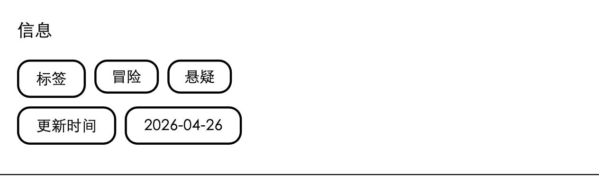 |  |

| 窄宽度 | 窄宽度与长标签 |
|---|---|
| 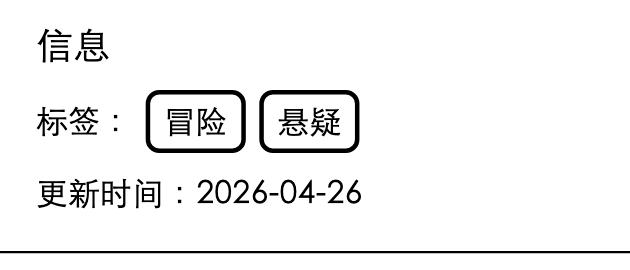 | 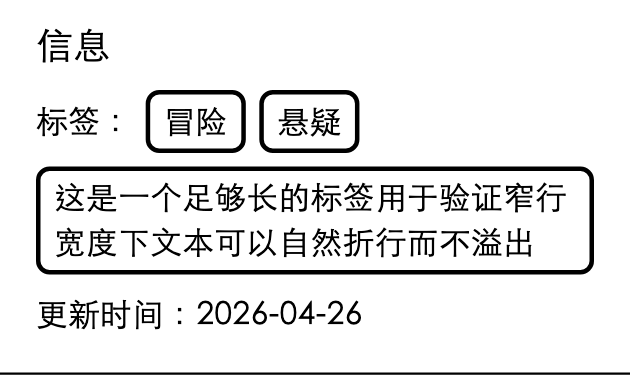 |

2 倍字体：

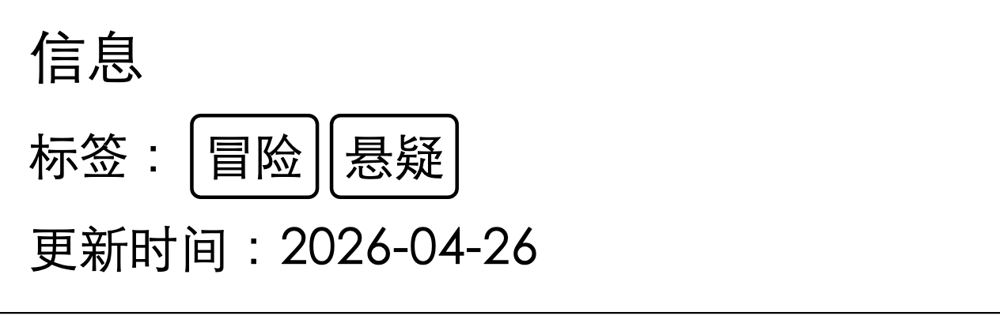

评分、作者、上传时间、浏览量和页数等信息同时存在：

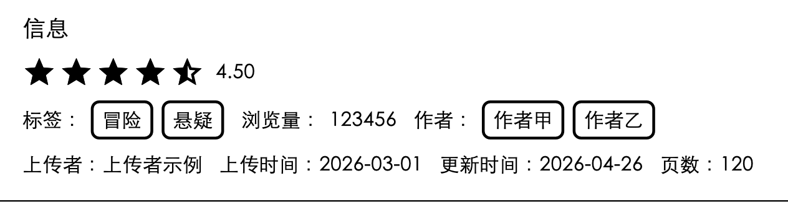

只有更新时间：

日期中文字与数字视觉上略有高低差。源码中二者是同一个 Text、共用基线；替代字体数字的可见字形较矮。用户确认先暂缓，待核对设备字体再决定处理，不添加固定像素偏移，也不把本地字体外观认定为实机缺陷。

### 已读／看过与手动标记

✓ 表示已读、○ 表示看过、无符号表示未读；黑底表示上次读到。测试中第 4 话保存位置为第 25 页，手动标为已读后保留该位置，黑底上的 ○ 变为白色 ✓；再标未读同时清除已读与看过。这里验证生产状态转换与界面，未代替真实设备持久化和跨设备同步。

| 三种状态与续读位置 | 第 4 话手动标为已读后 |
|---|---|
| 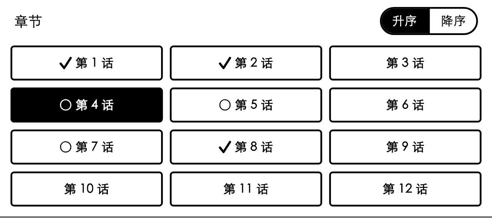 |  |

| 完整模拟视口 | 长按菜单 |
|---|---|
| 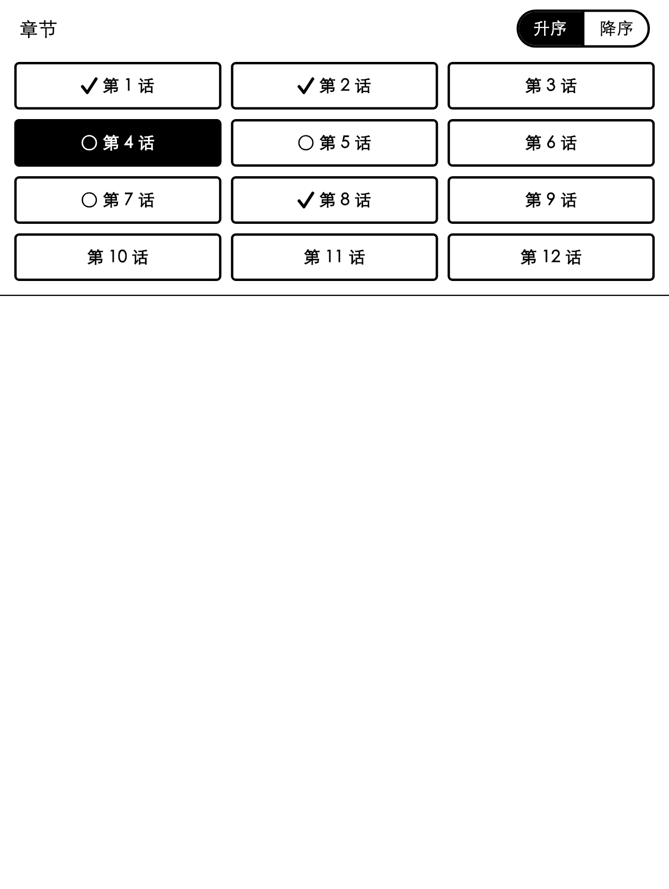 | 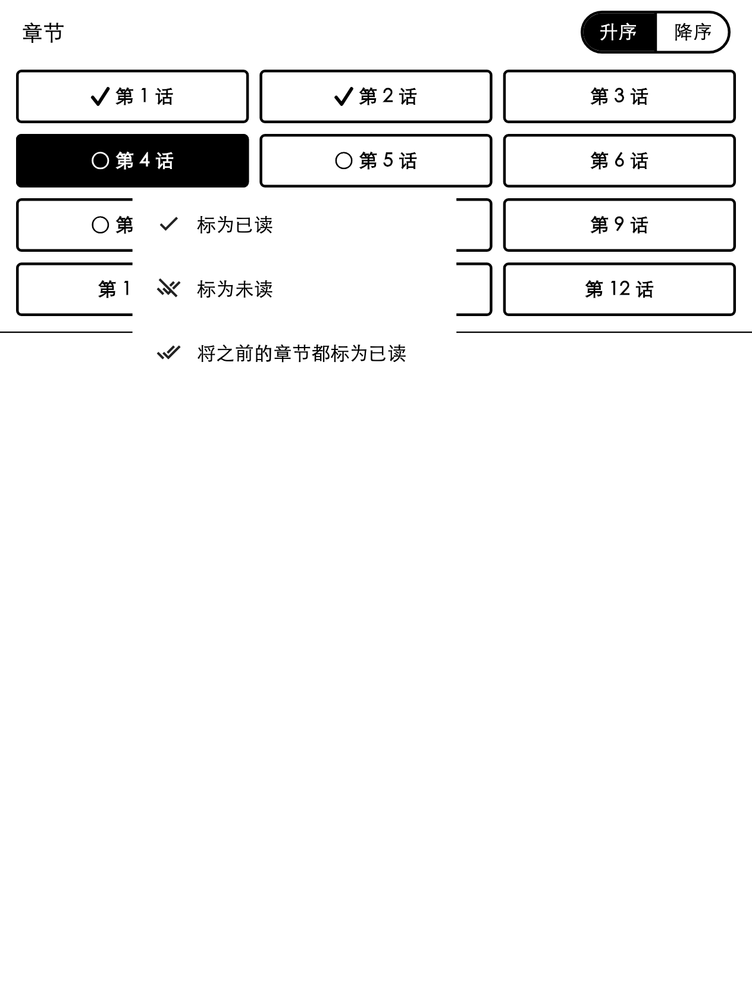 |

### 收藏缩略图

两种生产布局的四张缩略图均验证为常态 2dp 黑边和直角；画廊点击选择后选中标记正常。

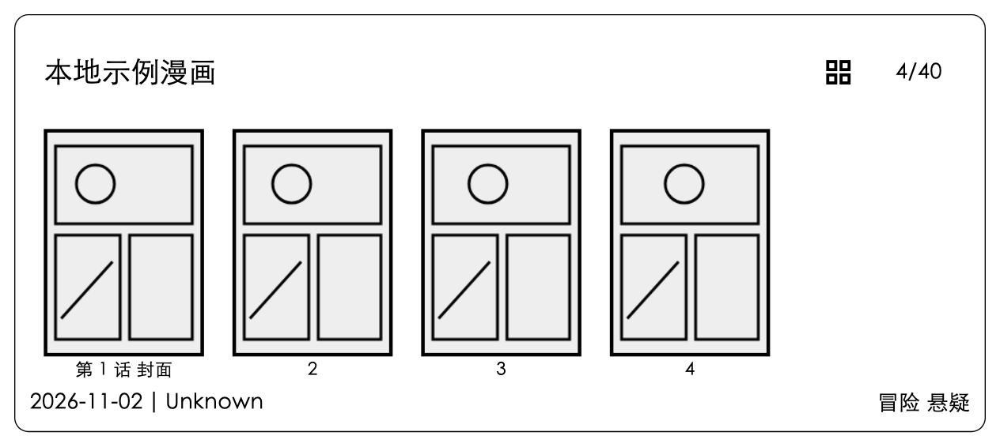

| 画廊普通状态 | 选中第一张 |
|---|---|
| 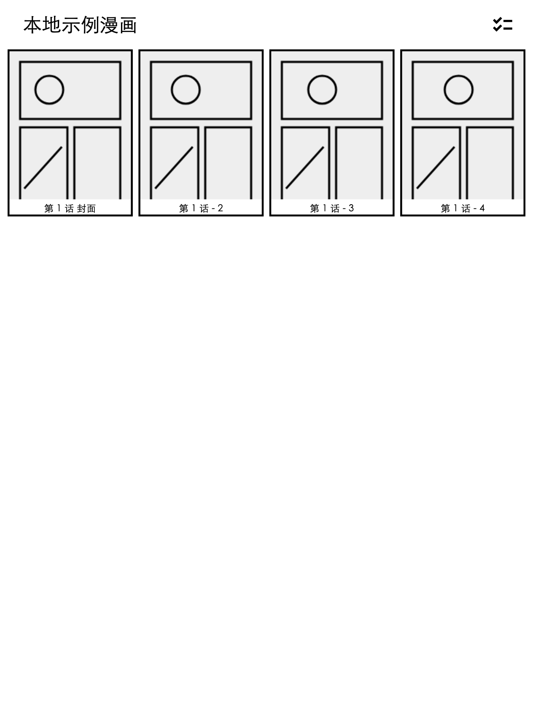 | 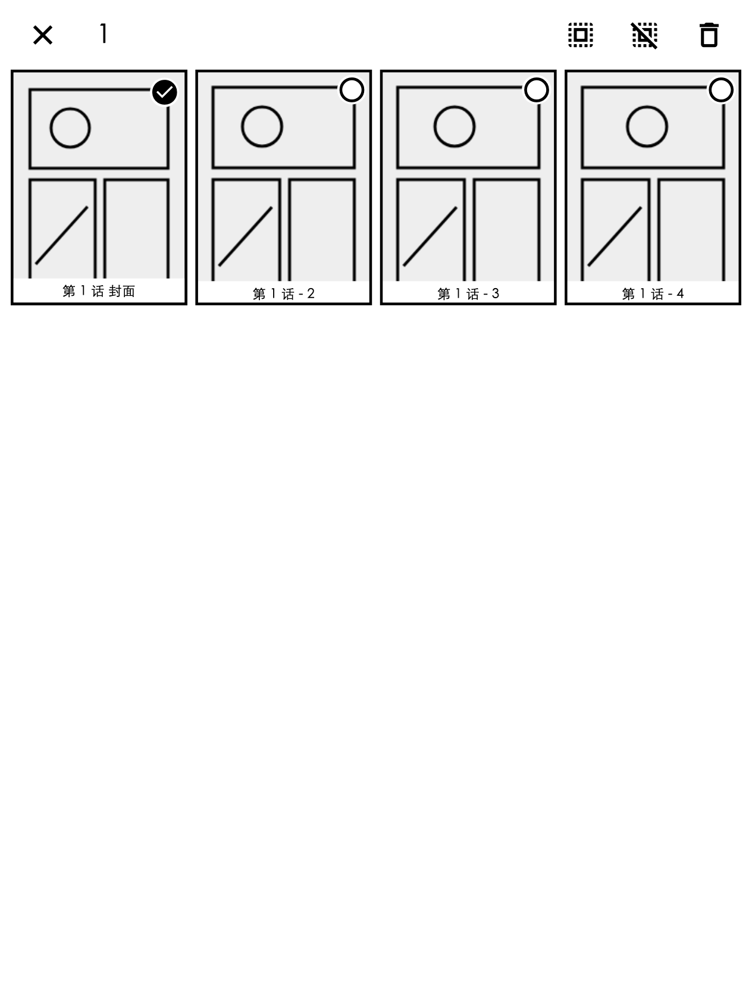 |

### 原有加载弹窗的适配

这是原有 `showLoadingDialog`，用于更新漫画源、追更检查、刷新历史资料、本地导入／导出或 WebDAV 归档等耗时操作。截图在空白测试页单独调出该生产组件，本次没有新增功能入口或阅读器加载流程。

未知总量显示静态半条，不代表 50% 完成；确定进度按实际值更新。定向测试确认首帧完成转场，未知进度不持续调度帧，确定值从 20% 更新至 80%，关闭立即生效。静态截图只展示最终外观，不能单独证明无动画。

| 未知总量的静态指示 | 确定进度 80% |
|---|---|
|  |  |

## 未验证范围

- 新功能在 Leaf5+ 上的真实续读、手标和墨水屏观感；设备实际 DPI、字体缩放、系统边距以及面板残影。
- 新功能的固定签名覆盖升级与数据保留、WebDAV 跨设备往返。
- 新版应用内完整下载安装，以及既有更新方案中的剩余异常组合。
- 瓜子首次空结果的源端网络／解析原因、硬件全刷和耗电对照。

上述范围继续维护在[待办清单](../LEAF_DEVELOPMENT_PLAN.md#7-待办与验证)。模拟图与自动检查通过不替代实机结论，也不代表已发布新的正式版本。
